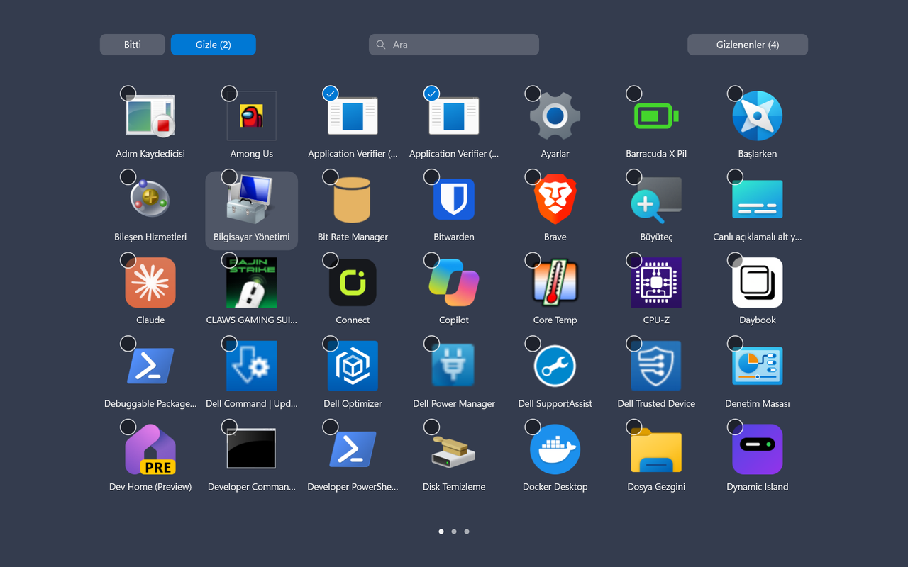
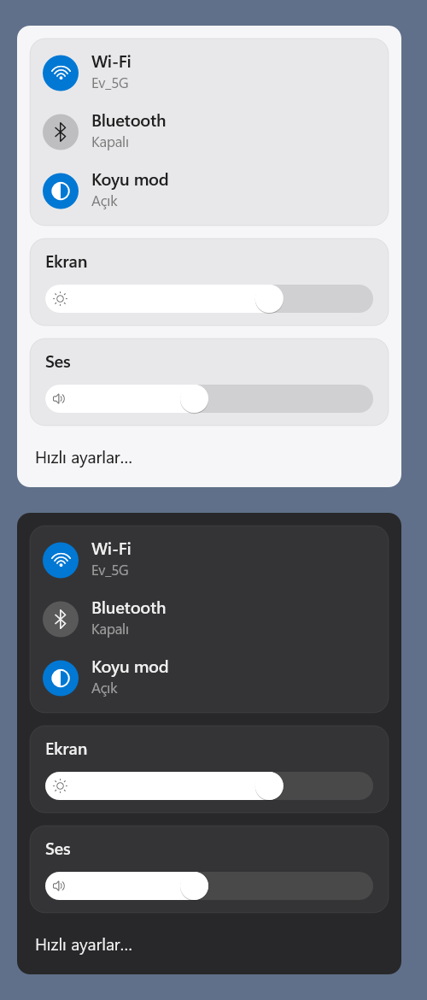
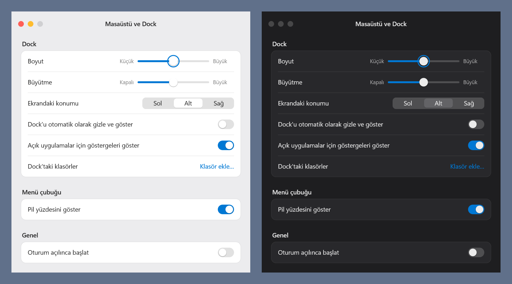

<h1 align="center">Mac-style Taskbar for Windows</h1>

<p align="center">
  Replaces the Windows taskbar with a menu bar at the top and a dock at the bottom, modelled on macOS: magnifying dock, Launchpad, Control Center, tray icons in the menu bar.
</p>

<p align="center">
  <a href="https://github.com/nightdevx/mac-taskbar-windows/releases/latest"></a>
  
  
  <a href="LICENSE"></a>
</p>

<p align="center">
  <b>English</b> · <a href="README.tr.md">Türkçe</a>
</p>

<p align="center">
  
</p>
<p align="center">
  
</p>

> [!NOTE]
> The interface is in Turkish for now. The pictures come from the app's own `--snapshot` renderer, which draws a flat background where the live bars show the blurred desktop.

## Features

- **Menu bar:** the Windows logo menu (about this PC, settings, sleep, restart, shut down, lock, sign out), the name of the app in front, tray icons, sound, battery with percentage, Wi-Fi and the clock. A right click on empty space opens the bar's own menu. Every monitor gets a bar.
- **Dock:** pinned and running apps with a dot under the running ones. Icons magnify under the pointer and bounce while an app starts or when one asks for attention. Hovering shows live window previews. The right-click menu has the usual Windows options. The dock can sit on the left, bottom or right edge and can hide until the pointer reaches the edge.
- **Folders and Recycle Bin:** to the right of the separator, as on macOS. A folder opens as a grid of its newest files. The Recycle Bin shows whether it is empty and can be emptied after a second confirmation.
- **Launchpad:** every installed app on full-screen pages over the blurred desktop, with search. Pages slide with the mouse wheel, the arrow keys, a two-finger swipe or a three-finger swipe on a precision touchpad. Select several apps to hide them; the hidden ones have their own view to bring them back.
- **Control Center:** Wi-Fi, Bluetooth and dark mode switches, display brightness and volume.
- **Panels:** a calendar under the clock, nearby Wi-Fi networks, battery and power mode, volume.
- **Settings window:** dock size, magnification, position, auto-hide, running-app dots, dock folders, battery percentage and start at sign-in. Changes apply at once.
- **Gets out of the way:** the bars hide while a full-screen app or game runs. Turning off Windows' animation effects also turns off Launchpad's and the dock's animations.

<p align="center">
  
</p>
<p align="center">
  
  &nbsp;
  
</p>

## Light on your PC

A native Rust app with no runtime or browser engine. It draws with Direct2D into Windows' compositor, so animations run in DWM and the app sleeps when nothing changes. Measured on a laptop with two monitors:

| | |
|---|---|
| CPU at idle | about 0 ms over 60 s |
| Memory (private) | about 25–33 MB |
| Start-up | 0.2 s without windows, 1–1.5 s with the bars on screen |
| Program size | under 1 MB, a single `.exe` |

## Install

1. Download `taskbar.exe` from the [latest release](https://github.com/nightdevx/mac-taskbar-windows/releases/latest).
2. Run it. The Windows taskbar hides, and the menu bar and dock appear.
3. To start it with Windows, open the settings (Windows logo → Dock ayarları…) and turn on "Oturum açılınca başlat".

The settings file is `%LOCALAPPDATA%\taskbar\settings.txt` and the log is `%LOCALAPPDATA%\taskbar\log.txt`.

### Getting the Windows taskbar back

Quit from the Windows logo menu ("Menü çubuğu ve Dock'tan çık"). The Windows taskbar comes back as it was.

If the app ever stops without cleaning up, run:

```
taskbar.exe --restore
```

### Command line

| Option | What it does |
|---|---|
| `--settings` | Opens the settings window (also in an instance that is already running) |
| `--quit` | Closes the running instance cleanly |
| `--restore` | Brings the Windows taskbar back |
| `--snapshot <file.png>` | Renders the bars, panels, settings and Launchpad to PNG files without opening windows |
| `--hidden` | Runs without showing anything, for resource measurements |

## Good to know

- Built and tested on Windows 11. Windows 10 has not been tried.
- If Windows' own three-finger gesture switches apps while Launchpad is open, set it to "Nothing" in Settings → Bluetooth & devices → Touchpad → Three-finger gestures.
- Tray icons show in colour and have no tooltips yet. If the bar runs out of room, the icons that do not fit are left out.
- Brightness works on built-in laptop screens only.
- Screen readers are not supported.

## Building from source

You need [Rust](https://rustup.rs) (stable, 2024 edition) on Windows.

```
cargo build --release
cargo test
```

The program is at `target\release\taskbar.exe`. Tests marked `#[ignore]` read or change real system state (radios, registry, monitors) and only run on request, for example `cargo test brightness -- --ignored --nocapture`.

The source is in `src/`, one file per part. `menubar.rs`, `dock.rs`, `launchpad.rs` and `panels.rs` are the surfaces. `tray.rs` collects the tray icons, `appbar.rs` reserves the screen edges, and `gfx.rs` holds the drawing code.

## License

[MIT](LICENSE) © nightdijital · [nightdijital.com](https://nightdijital.com) · iletisim@nightdijital.com

Not affiliated with Apple. macOS, Dock and Launchpad are trademarks of Apple Inc.
