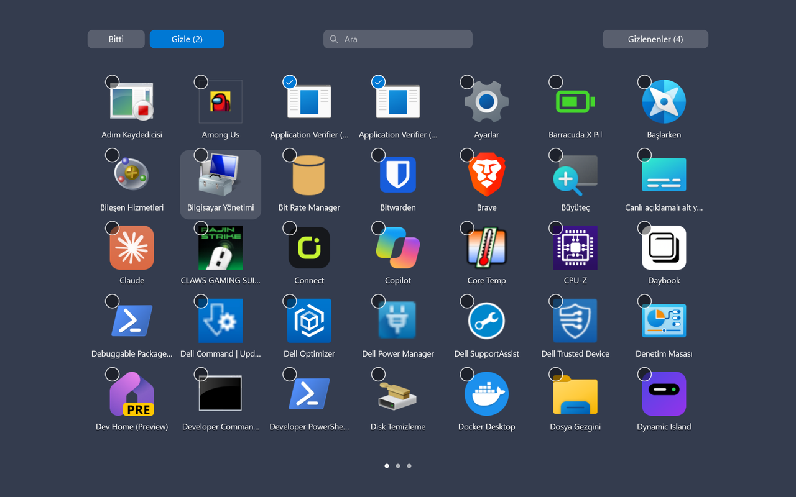
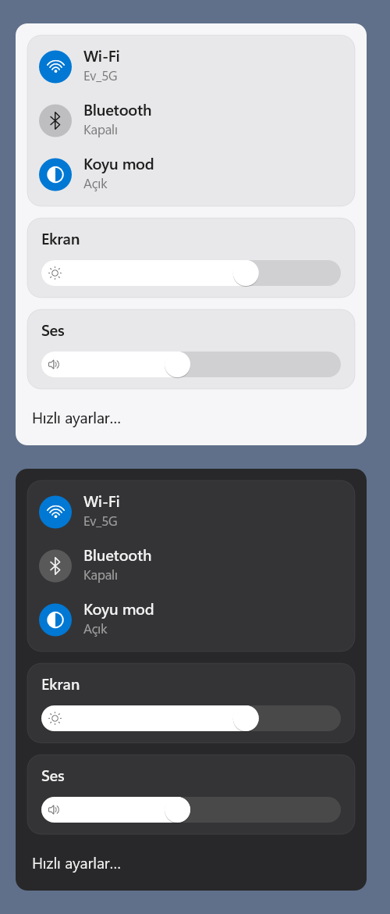
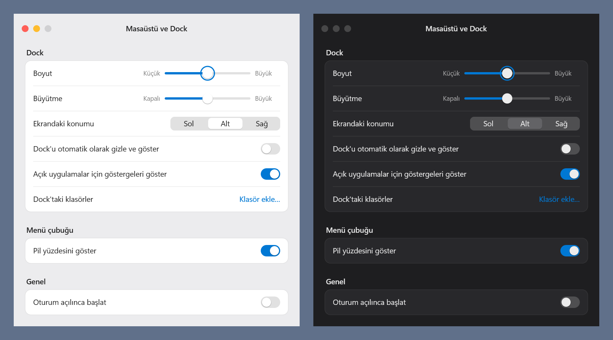

<h1 align="center">Windows için Mac tarzı görev çubuğu</h1>

<p align="center">
  Windows görev çubuğunun yerine macOS örnek alınarak yapılmış üstte bir menü çubuğu, altta bir dock: büyüyen ikonlar, Launchpad, Kontrol Merkezi, menü çubuğunda tepsi ikonları.
</p>

<p align="center">
  <a href="https://github.com/nightdevx/mac-taskbar-windows/releases/latest"></a>
  
  
  <a href="LICENSE"></a>
</p>

<p align="center">
  <a href="README.md">English</a> · <b>Türkçe</b>
</p>

<p align="center">
  
</p>
<p align="center">
  
</p>

> [!NOTE]
> Görseller uygulamanın kendi `--snapshot` çizimiyle üretildi. Canlı çubukların arkasında bulanık masaüstü görünür, görsellerde düz renk var.

## Özellikler

- **Menü çubuğu:** Windows logosu menüsü (bu bilgisayar hakkında, ayarlar, uyku, yeniden başlat, kapat, kilitle, oturumu kapat), öndeki uygulamanın adı, tepsi ikonları, ses, yüzdeli pil, Wi-Fi ve saat. Boş yere sağ tıklayınca çubuğun kendi menüsü açılır. Her monitörde bir çubuk olur.
- **Dock:** sabitlenmiş ve açık uygulamalar, açık olanların altında nokta. İkonlar imlecin altında büyür; uygulama açılırken ya da dikkat isterken zıplar. Üzerine gelince pencerelerin canlı önizlemesi çıkar. Sağ tık menüsünde Windows'taki seçenekler var. Dock sol, alt ya da sağ kenarda durabilir; imleç kenara gelene kadar gizlenebilir.
- **Klasörler ve Çöp Sepeti:** macOS'taki gibi ayırıcının sağında. Klasöre tıklayınca en yeni dosyaları ızgara olarak açılır. Çöp Sepeti boş mu dolu mu gösterir; ikinci bir onayla boşaltılır.
- **Launchpad:** yüklü tüm uygulamalar bulanık masaüstü üstünde tam ekran sayfalarda, arama ile. Sayfalar fare tekerleği, ok tuşları, iki parmak kaydırma ya da precision touchpad'de üç parmak kaydırma ile geçer. Birden çok uygulamayı seçip gizleyebilirsin; gizlenenler kendi görünümlerinden geri getirilir.
- **Kontrol Merkezi:** Wi-Fi, Bluetooth ve koyu mod anahtarları, ekran parlaklığı ve ses.
- **Paneller:** saatin altında takvim, yakındaki Wi-Fi ağları, pil ve güç modu, ses.
- **Ayarlar penceresi:** dock boyutu, büyütme, konum, otomatik gizleme, açık uygulama noktaları, dock klasörleri, pil yüzdesi ve oturum açılınca başlatma. Değişiklikler hemen uygulanır.
- **Araya girmez:** tam ekran uygulama ya da oyun açıkken çubuklar gizlenir. Windows'ta animasyon efektleri kapalıysa Launchpad ve dock animasyonları da kapanır.

<p align="center">
  
</p>
<p align="center">
  
  &nbsp;
  
</p>

## Bilgisayarı yormaz

Çalışma zamanı ya da tarayıcı motoru olmayan, yerel bir Rust uygulaması. Direct2D ile Windows'un bileşicisine çizer; animasyonlar DWM'de çalışır, değişen bir şey yokken uygulama uyur. İki monitörlü bir dizüstünde ölçüldü:

| | |
|---|---|
| Boştayken işlemci | 60 sn'de yaklaşık 0 ms |
| Bellek (private) | yaklaşık 25–33 MB |
| Açılış | pencere göstermeden 0,2 sn, çubuklar ekrandayken 1–1,5 sn |
| Program boyutu | 1 MB altı, tek `.exe` |

## Kurulum

1. [Son sürümden](https://github.com/nightdevx/mac-taskbar-windows/releases/latest) `taskbar.exe` dosyasını indir.
2. Çalıştır. Windows görev çubuğu gizlenir, menü çubuğu ve dock gelir.
3. Windows ile birlikte açılması için ayarları aç (Windows logosu → Dock ayarları…) ve "Oturum açılınca başlat"ı aç.

Ayar dosyası `%LOCALAPPDATA%\taskbar\settings.txt`, log `%LOCALAPPDATA%\taskbar\log.txt`.

### Windows görev çubuğunu geri almak

Windows logosu menüsünden "Menü çubuğu ve Dock'tan çık"ı seç. Windows görev çubuğu eskisi gibi geri gelir.

Uygulama bir gün temizlemeden kapanırsa şunu çalıştır:

```
taskbar.exe --restore
```

### Komut satırı

| Seçenek | Ne yapar |
|---|---|
| `--settings` | Ayarlar penceresini açar (çalışan bir örnek varsa onda da) |
| `--quit` | Çalışan örneği düzgünce kapatır |
| `--restore` | Windows görev çubuğunu geri getirir |
| `--snapshot <dosya.png>` | Çubukları, panelleri, ayarları ve Launchpad'i pencere açmadan PNG'ye çizer |
| `--hidden` | Hiçbir şey göstermeden çalışır, kaynak ölçümü için |

## Bilmekte fayda var

- Windows 11'de yapıldı ve denendi. Windows 10'da denenmedi.
- Launchpad açıkken Windows'un kendi üç parmak hareketi uygulama değiştiriyorsa Ayarlar → Bluetooth ve cihazlar → Dokunmatik yüzey → Üç parmak hareketleri'ni "Hiçbir şey" yap.
- Tepsi ikonları renkli görünür, henüz ipucu (tooltip) yok. Çubukta yer kalmazsa sığmayan ikonlar gösterilmez.
- Parlaklık yalnız dizüstü bilgisayarların dahili ekranında çalışır.
- Ekran okuyucu desteklenmiyor.

## Kaynaktan derleme

Windows'ta [Rust](https://rustup.rs) (stable, 2024 edition) gerekir.

```
cargo build --release
cargo test
```

Program `target\release\taskbar.exe` olarak çıkar. `#[ignore]` ile işaretli testler gerçek sistem durumunu okur ya da değiştirir (radyolar, kayıt defteri, monitörler); yalnız istenince çalışır, örneğin `cargo test brightness -- --ignored --nocapture`.

Kaynak `src/` altında, her parça ayrı dosyada. `menubar.rs`, `dock.rs`, `launchpad.rs` ve `panels.rs` yüzeylerdir. `tray.rs` tepsi ikonlarını toplar, `appbar.rs` ekran kenarlarını ayırır, `gfx.rs` çizim kodunu tutar.

## Lisans

[MIT](LICENSE) © nightdijital · [nightdijital.com](https://nightdijital.com) · iletisim@nightdijital.com

Apple ile bağlantısı yoktur. macOS, Dock ve Launchpad, Apple Inc.'in ticari markalarıdır.
